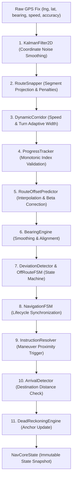
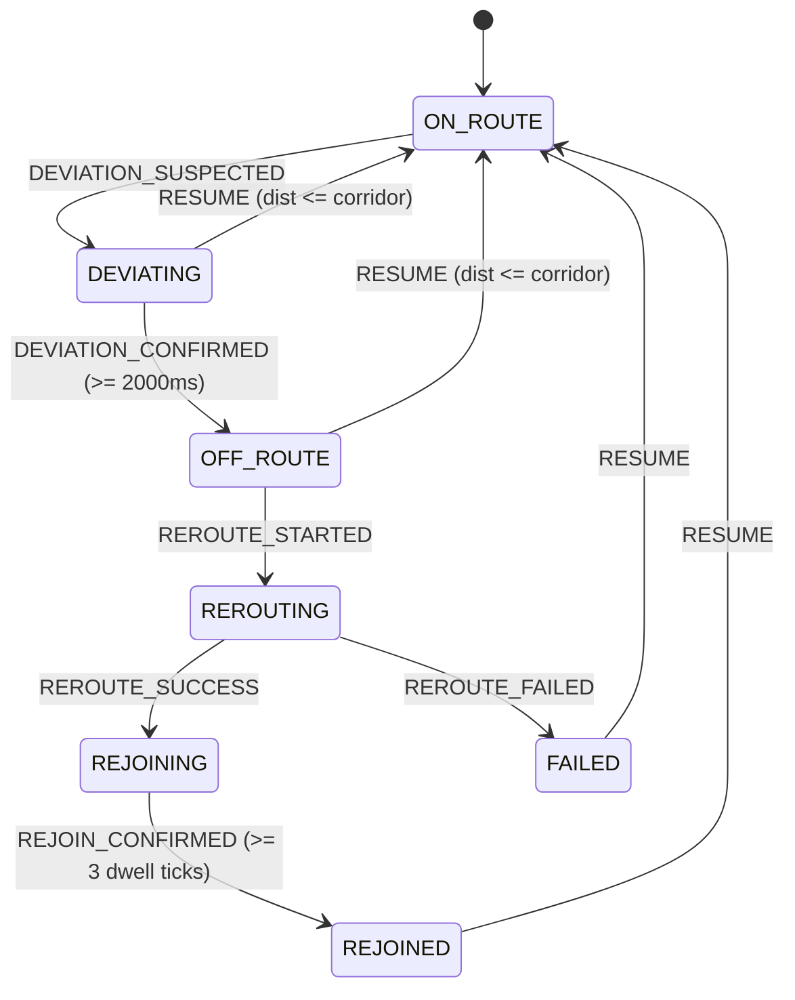
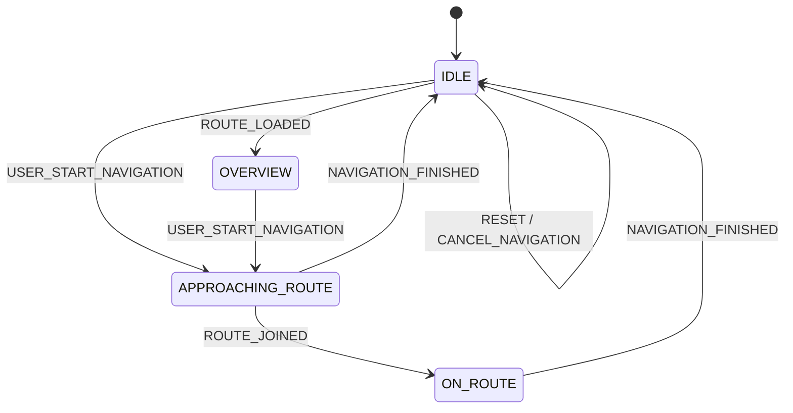

# Architecture & Pipeline Concepts

NavCore executes an explicit, deterministic 11-stage pipeline on every incoming GPS fix. Every calculation is performed with pure mathematical functions without hidden state or external network calls.

---

## The 11-Stage Pipeline

---

## Detailed Pipeline Stages & Constants

All constants cited below are defined in [`packages/core/src/constants.ts`](file:///E:/WORKSPACE/expo_projects/navcore-sdk/packages/core/src/constants.ts).

### Stage 1: Kalman Filter (`KalmanFilter2D`)
Reduces random sensor jitter on measured coordinates:
- **Degree-Based Operation**: The filter operates directly in angular degrees (`x: longitude`, `y: latitude`), calculating velocities in deg/s.
- **Process Noise (`Q`)**: Default `0.00001`. Lower values produce smoother paths at the expense of slight latency.
- **Measurement Noise Base (`rBase`)**: Default `0.00005`. Scaled dynamically by the reported GPS accuracy in metres:
  $$\text{R} = \text{rBase} \times \max\left(1, \frac{\text{accuracy}}{5}\right)$$

### Stage 2: Route Snapping (`RouteSnapper`)
Projects the filtered coordinate onto candidate route segments within a bounded forward search window:
- **Search Window (`SNAP_WINDOW_SIZE`)**: `25` segments.
- **Hard Distance Cutoff (`MAX_SNAP_DISTANCE`)**: `80` metres. Fixes further than $2 \times 80\text{m} = 160\text{m}$ are rejected.
- **Bearing Mismatch Penalty (`BEARING_MISMATCH_PENALTY`)**: `500` score points applied when vehicle heading diverges from segment bearing by more than `BEARING_MISMATCH_THRESHOLD` (`90°`), preventing U-turn false snaps.
- **Inertia Penalty (`INERTIA_PENALTY`)**: `200` score points applied when jumping more than `INERTIA_SEGMENT_DIST` (`5`) segments away from the previous segment.

### Stage 3: Dynamic Corridor (`calculateDynamicCorridor`)
Calculates the lateral threshold used to determine if the vehicle remains on route:
- **Base Width (`BASE_CORRIDOR_METERS`)**: `25` metres.
- **Speed Factor (`SPEED_CORRIDOR_FACTOR`)**: `1.2`.
- **GPS Accuracy Factor (`GPS_ACCURACY_FACTOR`)**: `0.5`.
- **Turn Anticipation Multiplier (`TURN_CORRIDOR_MULTIPLIER`)**: `1.4` (applied when a turn is detected within `TURN_LOOKAHEAD_DISTANCE_METERS = 40` metres).
- **Ceiling (`MAX_CORRIDOR_METERS`)**: `60` metres.

### Stage 4: Progress Tracking (`validateProgressUpdate`)
Guarantees monotonic route progression:
- Rejects backward regression along route geometry.
- Handles closed-loop circuit wrapping if `isCircuit: true` is configured and progress exceeds 70% of route length.

### Stage 5: Route Offset Predictor (`applyGpsCorrection`)
Maintains a continuous sub-segment linear offset along the route:
- **Beta Correction Factor (`BETA_CORRECTION`)**: `0.15` (blends 15% measured projection with 85% dead-reckoned offset).
- **Lookahead Window (`LOOK_AHEAD_SECONDS`)**: `3` seconds (clamped between `MIN_LOOK_AHEAD_METERS = 20`m and `MAX_LOOK_AHEAD_METERS = 100`m).

### Stage 6: Bearing Smoothing (`applyBearingSmoothing`)
Produces stable camera and vehicle orientation:
- **Smoothing Alpha (`BEARING_SMOOTHING_ALPHA`)**: `0.3` (exponential moving average).
- **Minimum Speed Threshold (`BEARING_MIN_SPEED_MPS`)**: `1.5` m/s (~5.4 km/h). Below this speed, GPS heading is considered unreliable and last known bearing is retained.
- **Alignment Gate (`BEARING_ALIGNMENT_THRESHOLD`)**: `55°`.

---

## State Machines

### Off-Route State Machine (`OffRouteFSM`)

The off-route system tracks whether the vehicle is traversing the planned geometry, deviating, rerouting, or rejoining:

#### Deviation Signals & Known Limitations
Compound deviation in `DeviationDetector` requires two concurrent conditions:
$$\text{confirmed} = \text{outsideCorridor} \land (\text{bearingMismatch} \lor \text{movingAway})$$
Where:
- `outsideCorridor`: distance to segment $> \text{corridor}$.
- `bearingMismatch`: difference between GPS bearing and segment bearing $> 90^\circ$.
- `movingAway`: vehicle speed $> 1.5\text{ m/s}$ and distance to next segment increases by $> 5\text{ m}$ in one tick.

> [!WARNING]
> **Known Behavior (Slow Drift):**
> If a vehicle drifts slowly and gradually away from the road while moving parallel to it ($\text{bearing mismatch} \le 90^\circ$ and change per tick $\le 5\text{m}$), `confirmed` remains `false`. The engine will not transition to `OFF_ROUTE` until either bearing diverges or lateral separation triggers rapid distance expansion.

### Lifecycle State Machine (`NavigationFSM`)

`NavigationFSM` synchronizes the overall navigation lifecycle:

---

## Additional Core Modules

### Voice Trigger Engine (`VoiceTriggerEngine`)
Converts upcoming maneuvers into timed instruction cues for your text-to-speech (TTS) engine.
- **SDK does not speak**: The engine emits `VoiceCue` objects; the host application passes the text to its platform speech API.
- **Trigger Distances**:
  - `earlyTriggerMeters`: `120` m (default trigger distance).
  - `lateTriggerMeters`: `20` m (cutoff threshold; past this distance, cue is cancelled).
  - `reannounceMeters`: `300` m (early pre-warning distance for high-speed approaches).
- **Priorities**:
  - `dist < 30m`: `'urgent'`
  - `dist < 60m`: `'high'`
  - `dist <= 120m`: `'normal'`
  - Re-announcement: `'low'`

### Offline ETA Engine (`ETAEngine`)
Calculates estimated time of arrival using a rolling window of recent vehicle speeds:
- No remote traffic API dependencies.
- Retains last reliable speed when vehicle stops at traffic lights to prevent division-by-zero or infinite ETAs.
- Computes `isReliable: boolean` flag so the UI can mask inaccurate estimates during initial departure.

### Geofencing Engine (`GeofencingEngine`)
Monitors circular and arbitrary polygonal geographic boundaries locally on the client:
- Haversine circle checks and ray-casting polygon intersection.
- Events emitted: `enter`, `exit`, and `dwell` (recurring every `dwellThresholdMs = 10000ms`).